

  
   
   
  

  <picture>
    <source media="(prefers-color-scheme: dark)" srcset="./assets/terminal-card-dark.svg" />
    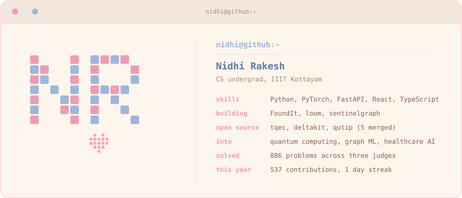
  </picture>

  Computer science undergrad at IIIT Kottayam. Most of my time goes to AI and machine 
  learning, from graph neural networks and healthcare AI to LLM applications, and 
  lately to quantum computing. I like problems where the hard part is the thinking.

 

  <picture>
    <source media="(prefers-color-scheme: dark)" srcset="./assets/headings/currently-dark.png" />
    
  </picture>

  <b>building:</b> FoundIt, a campus lost and found platform 
  <b>contributing:</b> quantum open source, Cirq and QuTiP among them 
  <b>learning:</b> quantum error correction and graph machine learning 
  <b>open to:</b> internships and collaborations

 

  <picture>
    <source media="(prefers-color-scheme: dark)" srcset="./assets/headings/tools-dark.png" />
    
  </picture>

  
  
  
  
  
  
  
  
   

  
  
  
  
  
  
  
   

  
  
  
  
  
  
  
  
  
   

  
  
  
  
  
  
  
  
  
  
   

  
  
  
   

  
  
  
  
  
  
  
  

 

  <picture>
    <source media="(prefers-color-scheme: dark)" srcset="./assets/headings/stats-dark.png" />
    
  </picture>

  <picture>
    <source media="(prefers-color-scheme: dark)" srcset="./assets/github-card-dark.svg" />
    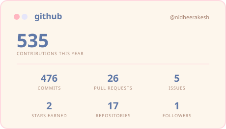
  </picture>
   
   
  <picture>
    <source media="(prefers-color-scheme: dark)" srcset="./assets/streak-card-dark.svg" />
    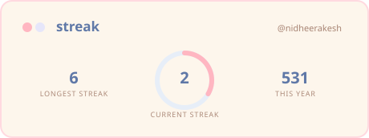
  </picture>

  <picture>
    <source media="(prefers-color-scheme: dark)" srcset="./assets/langs-card-dark.svg" />
    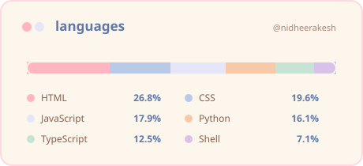
  </picture>

 

  <picture>
    <source media="(prefers-color-scheme: dark)" srcset="./assets/headings/city-dark.png" />
    
  </picture>

  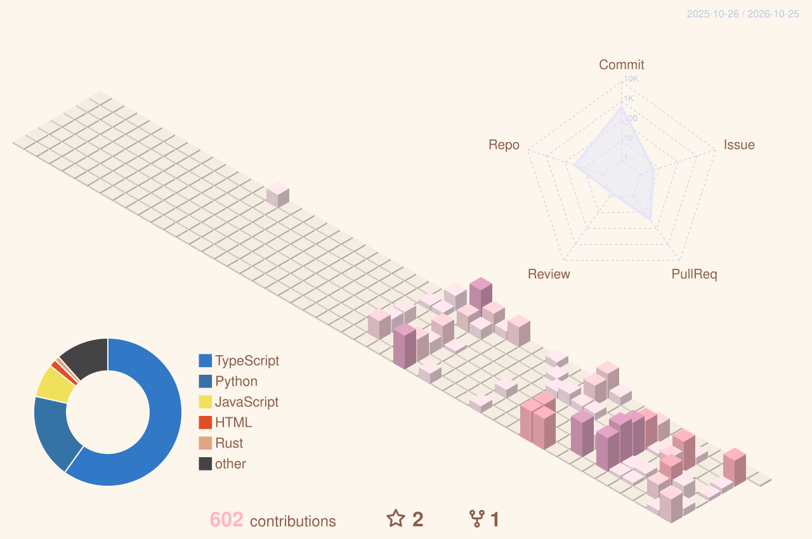

 

  <picture>
    <source media="(prefers-color-scheme: dark)" srcset="./assets/headings/oss-dark.png" />
    
  </picture>

  <picture>
    <source media="(prefers-color-scheme: dark)" srcset="./assets/oss-card-dark.svg" />
    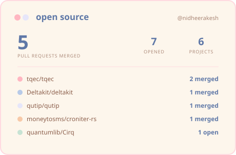
  </picture>

 

  <picture>
    <source media="(prefers-color-scheme: dark)" srcset="./assets/headings/dsa-dark.png" />
    
  </picture>

  <a href="https://codolio.com/profile/nidhirakesh05" target="_blank">
    <picture>
      <source media="(prefers-color-scheme: dark)" srcset="./assets/dsa-card-dark.svg" />
      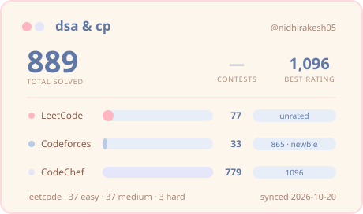
    </picture>
  </a>
   
   
  
  &nbsp;
  
  &nbsp;
  

 

  <picture>
    <source media="(prefers-color-scheme: dark)" srcset="./assets/headings/built-dark.png" />
    
  </picture>

<!-- PROJECTS:START -->

  <table>
    <tr>
      <td>
        <a href="https://github.com/nidheerakesh/loom">
          <picture>
            <source media="(prefers-color-scheme: dark)" srcset="./assets/projects/loom-dark.svg" />
            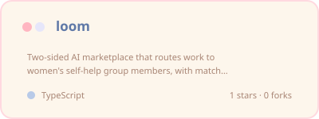
          </picture>
        </a>
      </td>
      <td>
        <a href="https://github.com/nidheerakesh/AEON">
          <picture>
            <source media="(prefers-color-scheme: dark)" srcset="./assets/projects/AEON-dark.svg" />
            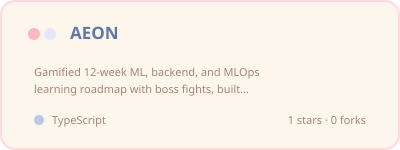
          </picture>
        </a>
      </td>
    </tr>
    <tr>
      <td>
        <a href="https://github.com/nidheerakesh/koode">
          <picture>
            <source media="(prefers-color-scheme: dark)" srcset="./assets/projects/koode-dark.svg" />
            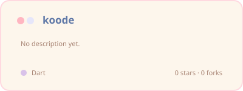
          </picture>
        </a>
      </td>
      <td>
        <a href="https://github.com/nidheerakesh/APKSentinel">
          <picture>
            <source media="(prefers-color-scheme: dark)" srcset="./assets/projects/APKSentinel-dark.svg" />
            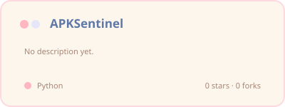
          </picture>
        </a>
      </td>
    </tr>
  </table>

<!-- PROJECTS:END -->

 

  <picture>
    <source media="(prefers-color-scheme: dark)" srcset="./assets/headings/hello-dark.png" />
    
  </picture>

  
  &nbsp;
  

 

  
   
   
  

